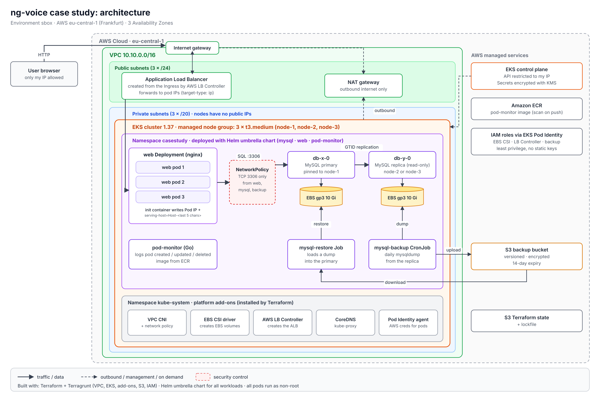

# ng-voice DevOps Case Study

A MySQL cluster, a web server and a Go pod monitor on **Amazon EKS**, built with **Terraform + Terragrunt** and deployed with one **Helm master chart**.



## Status

| # | Task | Status | Implementation | Details |
|---|------|--------|----------------|---------|
| 1 | Kubernetes cluster | Done | EKS 1.37 in a dedicated 3-AZ VPC, via Terragrunt | [live/](live/README.md), [modules/](modules/README.md) |
| 2 | DB cluster with persistent data | Done | MySQL 8.4, GTID primary/replica replication, EBS gp3 volumes | [Task 2](#task-2-mysql-cluster-with-persistent-data) |
| 3 | Web server | Done | nginx x3, mounted custom config, Pod IP + `serving-host` set by an init container, ALB Ingress | [Task 3](#task-3-web-server) |
| 4 | Only web pods may reach the DB on 3306 | Done | NetworkPolicy, enforced by the VPC CNI | [Task 4](#task-4-network-restriction-to-the-database) |
| 5 | Disaster recovery | Done | `mysqldump` CronJob to S3 + tested restore Job | [Task 5](#task-5-disaster-recovery) |
| 6 | Pods on a second network with routes | Done (demo on node-1) | Multus + ipvlan on a secondary ENI in its own subnet | [Task 6](#task-6-second-pod-network), [k8s/](k8s/README.md) |
| 7 | Pin DB replicas to specific nodes | Done | One StatefulSet per DB member, node affinity from values | [Task 7](#task-7-pin-db-replicas-to-specific-nodes) |
| P2 | Go pod monitor | Done | client-go informer logging pod created / updated / deleted | [app/pod-monitor/](app/pod-monitor/README.md) |
| P2 | Helm for all components | Done | master chart `case-study` with subcharts `mysql`, `web`, `pod-monitor` | [charts/case-study/](charts/case-study/README.md) |

## Repository layout

```
.
|-- root.hcl                 # Terragrunt root: S3 remote state, AWS provider, default tags
|-- live/sbox/               # per-environment config: env.hcl + one folder per unit     -> live/README.md
|-- modules/                 # own Terraform modules: eks-addons, mysql-backup, multus-net -> modules/README.md
|-- charts/case-study/       # Helm master chart + subcharts                              -> charts/case-study/README.md
|-- app/pod-monitor/         # Go source + Dockerfile                                       -> app/pod-monitor/README.md
|-- k8s/                     # raw manifests outside Helm (storage test, Multus)            -> k8s/README.md
`-- docs/architecture.png
```

**Principle:** `live/` says *what* runs in each environment, `modules/` says *how*, `charts/` is the application layer. Terraform owns infrastructure and platform add-ons; Helm owns the workloads.

## Prerequisites

- AWS account with IAM Identity Center and an `AdministratorAccess` permission set (no static keys)
- AWS CLI v2, Terraform >= 1.5.7, Terragrunt, kubectl, Helm 3, Docker (buildx), Go

```bash
aws configure sso                 # profile name: casestudy
export AWS_PROFILE=casestudy
aws sso login --profile casestudy
```

## Quick start

```bash
# 1. Infrastructure setup [more details in details: live/README.mds]
cd live/sbox/vpc && terragrunt backend bootstrap && cd ..
terragrunt run --all apply

# 2. Cluster access + node labels for task 7 for scheduling specific DB pod to specific nodes.
aws eks update-kubeconfig --name eks-casestudy-sbox-01 --region eu-central-1
kubectl label node <node-in-1a> casestudy.io/db-node=node-1
kubectl label node <node-in-1b> casestudy.io/db-node=node-2
kubectl label node <node-in-1c> casestudy.io/db-node=node-3

# 3. Pod monitor image                              details: app/pod-monitor/README.md

# 4. Multus (task 6)                                details: k8s/README.md

# 5. Application                                    details: charts/case-study/README.md
helm upgrade --install case-study charts/case-study -n casestudy --create-namespace
kubectl get pods,svc,ingress -n casestudy
```

---

## Task 1: Kubernetes cluster

- **VPC** `10.10.0.0/16`, 3 AZs, private `/20` subnets for nodes and pods, public `/24` subnets for the ALB and NAT only, single NAT gateway (sbox cost saving).
- **EKS 1.37**, managed node group (AL2023, 3 x `t3.medium`) in private subnets. API endpoint restricted to my IP; access via an EKS access entry for the SSO admin role (`authentication_mode = API`).
- **Add-ons:** VPC CNI with network policy enabled, Pod Identity agent, CoreDNS, kube-proxy, EBS CSI driver, AWS Load Balancer Controller.
- **Storage:** `gp3` StorageClass (encrypted, `WaitForFirstConsumer`, `Retain`, expandable, default).

Design decisions and apply order: [live/README.md](live/README.md). Module contents: [modules/README.md](modules/README.md).

```bash
kubectl get nodes -o wide -L topology.kubernetes.io/zone   # 3 Ready nodes, one per AZ
kubectl get storageclass                                   # gp3 (default)
```

## Task 2: MySQL cluster with persistent data

- Official `mysql:8.4` (LTS). One StatefulSet per member (`db-x` primary, `db-y` replica), each with its own 10 Gi gp3 PVC.
- **GTID replication** set up on first start by init scripts: the primary creates user `repl`; the replica runs `CHANGE REPLICATION SOURCE TO ... SOURCE_AUTO_POSITION=1` and sets `super_read_only`.
- Passwords generated by Helm once (`lookup`) and kept across upgrades and uninstalls. Never in Git.
- Runs as uid 999, all capabilities dropped, seccomp `RuntimeDefault`.

```bash
kubectl exec db-y-0 -n casestudy -c mysql -- sh -c \
  'MYSQL_PWD="$MYSQL_ROOT_PASSWORD" mysql -uroot -e "SHOW REPLICA STATUS\G"' | grep -E "Source_Host|Running"
kubectl exec db-y-0 -n casestudy -c mysql -- sh -c \
  'MYSQL_PWD="$MYSQL_ROOT_PASSWORD" mysql -uroot -e "INSERT INTO demo.t VALUES (1);"'   # ERROR 1290: read-only
kubectl delete pod db-x-0 -n casestudy   # data survives on the PVC
```

## Task 3: Web server

| Requirement | Implementation |
|-------------|----------------|
| Multiple replicas | Deployment `web`, 3 replicas |
| Custom config mounted and used | ConfigMap -> `/etc/nginx/conf.d/default.conf`; adds `X-Served-By` header and `/healthz` |
| Show the Pod IP | Downward API `status.podIP` |
| `serving-host` set by an init container | busybox init container replaces the placeholder with `Host-<last 5 chars of pod name>` |
| Browser access | Ingress -> ALB (`target-type: ip`), restricted to my IP; backend Service is `ClusterIP` |

> The task example shows `web-server-7f89cf47bf-25gxj` -> `Host-5gxj`, but the last 5 characters are `25gxj`. The written rule was followed.

```bash
ALB=$(kubectl get ingress web -n casestudy -o jsonpath='{.status.loadBalancer.ingress[0].hostname}')
for i in 1 2 3 4 5 6; do curl -s http://$ALB | grep -E "Pod IP|serving-host"; done
curl -sI http://$ALB | grep X-Served-By
```

## Task 4: Network restriction to the database

A NetworkPolicy selects all MySQL pods (`policyTypes: [Ingress]`) and allows TCP 3306 only from `app: web` (the requirement), `app: mysql` (replication) and `app: mysql-backup` (backup/restore jobs). Enforced by the VPC CNI's network policy agent.

```bash
kubectl run np-web   -n casestudy --rm -it --labels=app=web --image=busybox:1.37 --restart=Never -- nc -zv -w 3 db-x-0.mysql 3306  # open
kubectl run np-other -n casestudy --rm -it                  --image=busybox:1.37 --restart=Never -- nc -zv -w 3 db-x-0.mysql 3306  # timed out
```

Alternative considered: Cilium (L7/FQDN policies, Hubble). Not adopted, to avoid replacing the CNI on a running cluster.

## Task 5: Disaster recovery

- **S3 bucket** (versioned, encrypted, private, 14-day expiry) and a least-privilege **IAM role via Pod Identity**, both in `modules/mysql-backup`.
- **Backup:** daily CronJob. `mysqldump` from the **replica** (no load on the primary), upload to `s3://<bucket>/mysql/<timestamp>.sql`.
- **Restore:** opt-in Job that downloads a chosen dump and loads it into the **primary**; the replica follows via replication.
- **Tested:** dropped the `demo` database, restored it, data back on both primary and replica. Procedure: [charts/case-study/README.md](charts/case-study/README.md#restore).

| RPO | RTO |
|-----|-----|
| <= 24 h (schedule) | minutes (one Job) |

## Task 6: Second pod network

Pods get a second interface `net1` in a separate network with its own routes. No LoadBalancer is involved.

- **Network** (Terraform, `modules/multus-net`): subnet `10.10.64.0/24` in eu-central-1a, its own security group, and a secondary ENI attached to node-1. The ENI holds the pod IPs `.11-.13` as secondary IPs (otherwise the VPC drops their traffic) and is tagged `node.k8s.amazonaws.com/no_manage` so the VPC CNI ignores it.
- **Multus** (thick plugin, AWS manifest) chains in front of the VPC CNI; `eth0` stays the normal pod network.
- **NetworkAttachmentDefinition** `multus-net` (Helm): `ipvlan` on the ENI (`ens7`), `host-local` IPAM, route `10.20.0.0/16 via 10.10.64.1` (example external network, e.g. on-prem via VPN/TGW).
- Pods opt in with the annotation `k8s.v1.cni.cncf.io/networks: multus-net`.

```bash
kubectl apply -f k8s/multus/test-pods.yaml -n casestudy
kubectl -n casestudy exec multus-a -- ip addr              # net1 10.10.64.11/24
kubectl -n casestudy exec multus-a -- ip route             # 10.20.0.0/16 via 10.10.64.1 dev net1
kubectl -n casestudy exec multus-a -- ping -c 3 10.10.64.12   # 0% loss, pod to pod over net1
```

Limitations and setup steps: [k8s/README.md](k8s/README.md).

## Task 7: Pin DB replicas to specific nodes

A StatefulSet has one pod template, so it cannot map individual replicas to individual nodes. The chart renders **one StatefulSet per member** from values, each with required node affinity:

```yaml
members:
  - { name: db-x, role: primary, nodes: [node-1] }
  - { name: db-y, role: replica, nodes: [node-2, node-3] }
```

```bash
kubectl get nodes -L casestudy.io/db-node
kubectl get pods -n casestudy -l app=mysql -o wide
```

Alternatives considered: one StatefulSet with anti-affinity (no exact mapping) and a Kyverno mutation policy (extra component).

## Part 2

- **Go pod monitor:** [app/pod-monitor/README.md](app/pod-monitor/README.md)
- **Helm chart:** [charts/case-study/README.md](charts/case-study/README.md)

---

## Security summary

- All pods run as non-root with numeric UIDs (MySQL 999, nginx 101, pod-monitor 65532), no privilege escalation, capabilities dropped, seccomp `RuntimeDefault`, read-only root filesystems where possible.
- AWS access from pods only via **EKS Pod Identity** with least-privilege roles. No static keys anywhere; humans use SSO.
- Secrets generated in-cluster, never in Git, encrypted at rest with KMS.
- EKS API and ALB restricted to my IP; NetworkPolicy restricts who reaches the database.

## Known limitations

- No automatic MySQL failover (primary/replica only); production would use InnoDB Cluster or an operator.
- Backups use the root user; a dedicated backup user would be better.
- Node labels (task 7) are applied with `kubectl`; they belong in the node group definition.
- Task 6 is a single-node demo; the ENI is lost if node-1 is replaced and `ens7` was brought up manually.
- The ECR repository was created with the CLI instead of Terraform.
- The ALB serves HTTP only; HTTPS needs a domain + ACM certificate.

## Production hardening (next steps)

- One NAT gateway per AZ plus VPC endpoints (ECR, S3, STS)
- CI deployment role (GitHub Actions OIDC) instead of personal SSO for `apply`
- External Secrets with AWS Secrets Manager
- TLS on the ALB (ACM) and AWS WAF
- Pod Security Admission `restricted` on the namespace
- Images pinned by digest and mirrored to ECR
- Task 6: ENI via launch template + lifecycle hook, `whereabouts` IPAM

## Problems encountered

| Symptom | Cause | Fix |
|---------|-------|-----|
| `iam:GetRole` denied | Org SCP allowed only eu-central-1; IAM is evaluated in us-east-1 | Added us-east-1/us-west-2 to the SCP region list |
| Access entry: invalid principal | SSO role ARN without its path | Full ARN incl. `aws-reserved/sso.amazonaws.com/<region>/` |
| S3 state bucket missing | Terragrunt no longer creates it automatically | `terragrunt backend bootstrap` |
| `provider.tf already exists` | Module file collided with Terragrunt's generated file | Renamed to `helm-provider.tf` |
| `ErrImagePull` (web) | `nginxinc/` repository archived | `nginx/nginx-unprivileged` |
| `CreateContainerConfigError` | `runAsNonRoot` with a non-numeric image user | `runAsUser: 65532` |
| Restore ran on every upgrade | Helm reused earlier `--set` values | `--reset-values` |
| Multus `ImagePullBackOff` | AWS manifest points to the us-west-2 ECR registry | Same image from the eu-central-1 registry |
| ipvlan: no `net1` traffic | Hot-attached ENI was DOWN | `ip link set ens7 up` via a privileged node debug pod |

## Costs and teardown

Roughly $6-8 per day (EKS control plane, 3 x t3.medium, NAT gateway, ALB). Teardown order: [live/README.md](live/README.md#teardown).
